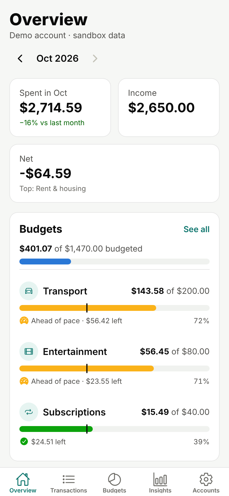
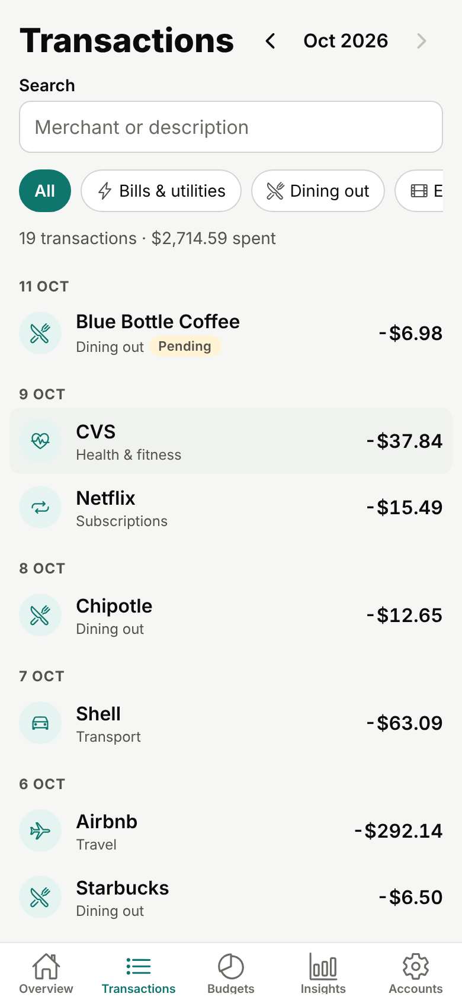
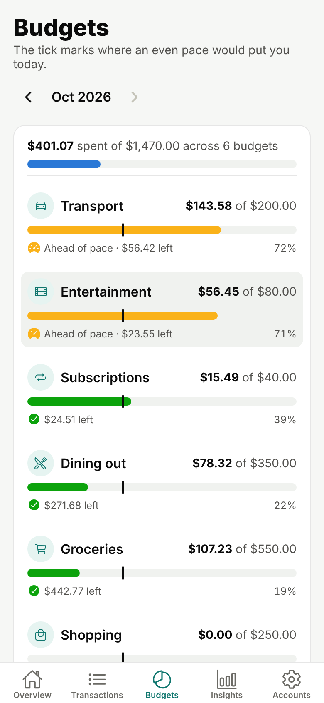
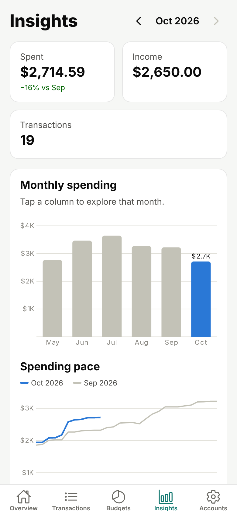
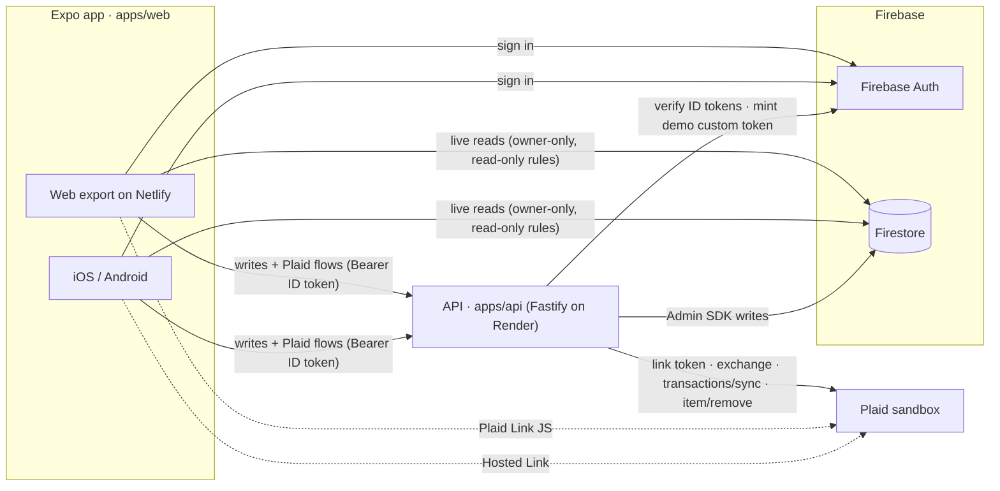

# BudgetWise

[](https://github.com/temitopeagbola/BudgetWise/actions/workflows/ci.yml)
[](https://github.com/temitopeagbola/BudgetWise/actions/workflows/eas-update.yml)

A personal finance app for people who want to see where their money goes: link a bank, get every
transaction categorised automatically, and keep each month on budget. Runs on iOS, Android and the web.

Web app: [budgetwise.temitopeagbola.com](https://budgetwise.temitopeagbola.com) (Netlify, see
[Deployment](#deployment)).

## Overview

BudgetWise connects to a bank through **Plaid** (sandbox only), imports the account's transactions and
sorts each one into a category using a rules engine you can override. You set a monthly limit per
category and watch progress against an even-pace marker; the Insights screen charts the last six months.
The app is an **Expo** (React Native) universal app. It reads your data live from **Firestore** but never
writes to it directly: every write, and everything that touches Plaid, goes through a small **Node.js
API**, which is the only component that holds the Plaid secret and bank access tokens. A built-in mock
bank lets the whole app run locally, in CI and in a one-click demo without any Plaid keys.

| Overview                                   | Transactions                                       | Budgets                                  | Insights                                   |
| ------------------------------------------ | -------------------------------------------------- | ---------------------------------------- | ------------------------------------------ |
|  |  |  |  |

## Key features

- **Accounts:** email/password sign-up and sign-in, password reset, and a one-click **Try the demo**
  that signs into a shared demo account with six months of seeded sandbox data (re-seeded when older
  than `DEMO_RESEED_HOURS`).
- **Bank linking:** Plaid Link JS on the web, Plaid Hosted Link on iOS/Android (works in Expo Go), and an
  in-app sandbox-bank sheet when the API runs with `PLAID_PROVIDER=mock`.
- **Transaction sync:** cursor-based `/transactions/sync` that handles added, modified, removed and
  pending → posted transactions; manual **Sync now**.
- **Categorisation you control:** your rules → curated merchant keywords → Plaid's personal-finance
  category → Other. Override any transaction, or turn an override into a rule ("Always use this
  category") that re-categorises past and future matches. Manual edits are never overwritten.
- **Rules editor:** match merchant or description (contains / equals / starts with), optional amount
  range, and a live preview of how many transactions match.
- **Monthly budgets** per category with progress, a pace marker for the current month, status icons
  and labels, and limits suggested from the last three months of spending.
- **Overview and Insights:** spent, income and net (or transaction count) tiles, a six-month spending
  chart (tap a month to select it), a spending-pace line chart against the previous month, and a
  category breakdown. Charts use **Victory
  Native** (Skia) on every platform; on the web, CanvasKit is lazy-loaded on the Insights screen.
- **Free-tier friendly:** the app pings the API on launch and shows "Waking the server…" while a sleeping
  Render instance starts; only requests that are safe to repeat are retried.
- Loading, empty and error states; accessible labels, roles and focus rings; responsive down to 375px.

## Tech stack

| Area           | Choice                                                                                       |
| -------------- | -------------------------------------------------------------------------------------------- |
| App            | Expo SDK 57, Expo Router, React Native 0.86, React 19, react-native-web, TypeScript (strict) |
| Charts         | Victory Native on `@shopify/react-native-skia`                                               |
| API            | Node.js 22, Fastify 5, zod 4, bundled with tsup                                              |
| Auth           | Firebase Authentication (email/password, custom tokens for the demo)                         |
| Database       | Cloud Firestore (client reads only; API writes via the Firebase Admin SDK)                   |
| Bank data      | Plaid sandbox (`plaid` Node client) or the built-in mock provider                            |
| Shared logic   | `@budgetwise/core`: domain types, zod schemas, categorisation, budget and insight maths      |
| Tests          | Vitest (unit), Playwright (e2e) against the Firebase Auth + Firestore emulators              |
| Hosting        | Netlify (web export), Render free web service (API), EAS Update (Expo Go)                    |
| CI             | GitHub Actions                                                                               |
| Local services | Docker Compose: Firebase emulators, API and the web export behind nginx                      |

## Architecture



- **One write path.** [`firestore.rules`](firestore.rules) lets a signed-in user _read_
  `users/{uid}/**` and nothing else; clients cannot write. The API verifies the Firebase ID token on
  every `/v1` request and validates input with zod schemas shared with the app.
- **Secrets stay server-side.** Plaid access tokens are AES-256-GCM encrypted (`TOKEN_ENCRYPTION_KEY`)
  in a server-only collection. Link sessions are stored by SHA-256 hash and bound to the user who
  started them.
- **Provider seam.** A `BankProvider` interface has two implementations, Plaid and a deterministic mock,
  selected by `PLAID_PROVIDER`. Each linked bank remembers which provider created it.

**Firestore collections** (no migrations; document shapes live in
[`packages/core/src/types.ts`](packages/core/src/types.ts)):

| Path                              | Contents                                        | Client access |
| --------------------------------- | ----------------------------------------------- | ------------- |
| `users/{uid}`                     | Profile (`isDemo`, `lastSyncedAt`)              | owner read    |
| `users/{uid}/items/{itemId}`      | Linked bank: institution, accounts, sync status | owner read    |
| `users/{uid}/transactions/{txId}` | Amount, date, merchant, category and its source | owner read    |
| `users/{uid}/rules/{ruleId}`      | Categorisation rules                            | owner read    |
| `users/{uid}/budgets/{category}`  | Monthly limit per category                      | owner read    |
| `itemSecrets/{itemId}`            | Encrypted Plaid access token and sync cursor    | none          |
| `linkSessions/{sha256}`           | Pending Link sessions bound to their user       | none          |

**API routes** ([`apps/api/src/app.ts`](apps/api/src/app.ts)): all `/v1` routes except the demo session
need `Authorization: Bearer <Firebase ID token>`. Rate limit: 120 requests/minute per IP (10 for demo
sessions, 20 for link tokens).

| Method                | Path                             | Purpose                                                 |
| --------------------- | -------------------------------- | ------------------------------------------------------- |
| GET                   | `/health`                        | Liveness and active provider                            |
| POST                  | `/v1/demo/session`               | Custom token for the demo account (re-seeds when stale) |
| POST                  | `/v1/session`                    | Create the user's profile on first sign-in              |
| POST                  | `/v1/plaid/link-token`           | Create a Plaid Link (or Hosted Link) token              |
| POST                  | `/v1/plaid/exchange`             | Exchange a public token and run the first sync          |
| POST                  | `/v1/plaid/hosted-link/complete` | Finish a Hosted Link session server-side                |
| POST                  | `/v1/sync`                       | Sync every linked bank                                  |
| DELETE                | `/v1/items/:id`                  | Unlink a bank and remove its transactions               |
| PATCH                 | `/v1/transactions/:id`           | Override a category, optionally creating a rule         |
| POST / PATCH / DELETE | `/v1/rules[/:id]`                | Manage rules (re-categorises affected transactions)     |
| PUT / DELETE          | `/v1/budgets/:category`          | Set or clear a monthly budget                           |

More detail: [docs/PLAN.md](docs/PLAN.md).

## Project structure

```
apps/
  web/              Expo Router app (iOS, Android, web export); screens in src/app
  api/              Fastify API: Plaid and mock providers, sync, rules, budgets, demo sessions
packages/
  core/             Shared types, zod schemas, categorisation engine, budget and insight maths
e2e/                Playwright smoke tests
infra/firebase/     Docker image for the Firebase Auth + Firestore emulators
scripts/            expo-go-qr.mjs (README QR code generator)
docs/               Plan, screenshots, Expo Go QR code
.github/workflows/  CI and EAS Update
firebase.json, firestore.rules, firestore.indexes.json   Firebase emulator and rules config
docker-compose.yml  The whole stack locally
netlify.toml        Netlify build for the web export
render.yaml         Render Blueprint for the API
```

## Getting started

### Prerequisites

- **Node.js 22** (see [`.nvmrc`](.nvmrc); `engines.node` is `>=22`) and npm
- **Java 21** for the Firebase emulators (CI uses Temurin 21). The Firebase CLI itself runs through
  `npx` (pinned to `firebase-tools@15.33.0`), so there is nothing else to install.
- **or** Docker with Compose v2 to run everything in containers
- Optional: the Expo Go app (SDK 57) to run the app on a phone

### Option A: Docker (one command)

```sh
docker compose up --build
```

| Service              | URL                          |
| -------------------- | ---------------------------- |
| Web app              | http://localhost:3000        |
| API                  | http://localhost:8787/health |
| Firebase Emulator UI | http://localhost:4000        |

This starts the Auth + Firestore emulators, the API (mock bank, demo account seeded on start) and the
web export behind nginx. No accounts or keys needed. To use the Plaid sandbox instead, put
`PLAID_PROVIDER=plaid`, `PLAID_CLIENT_ID` and `PLAID_SECRET` in a root `.env` before starting.

### Option B: Node (hot reload)

```sh
npm install
cp .env.example .env    # API settings: local emulators + mock bank (read by dev:api and seed)
printf 'EXPO_PUBLIC_USE_FIREBASE_EMULATORS=true\nEXPO_PUBLIC_API_URL=http://localhost:8787\n' > apps/web/.env.local

npm run emulators       # terminal 1: Auth :9099, Firestore :8080, Emulator UI :4000
npm run dev:api         # terminal 2: API on :8787 (seeds the demo account on start)
npm run dev:web         # terminal 3: Expo dev server, opens the web app on :8081
```

`npm run seed` re-seeds the demo account at any time.

**On a phone (Expo Go):** run `npm run start -w @budgetwise/web` and scan the QR code in the terminal.
When `EXPO_PUBLIC_API_URL` points at `localhost`, the app swaps in your computer's LAN address
automatically; to reach the emulators from the phone, also set `EXPO_PUBLIC_FIREBASE_EMULATOR_HOST` to
that address.

### Environment variables

Names and purposes only; [`.env.example`](.env.example) has working local defaults. Never commit real
values.

**API** (`apps/api`; on Render in production)

| Variable                                                 | Purpose                                                                                |
| -------------------------------------------------------- | -------------------------------------------------------------------------------------- |
| `NODE_ENV`                                               | `development`, `test` or `production`                                                  |
| `PORT`                                                   | Port to listen on (Render injects it)                                                  |
| `ALLOWED_ORIGINS`                                        | Comma-separated browser origins allowed by CORS                                        |
| `LOG_LEVEL`                                              | Pino log level                                                                         |
| `PLAID_PROVIDER`                                         | `mock` (built-in sandbox bank, no keys) or `plaid` (Plaid sandbox)                     |
| `PLAID_CLIENT_ID`, `PLAID_SECRET`                        | Plaid sandbox credentials; required with `PLAID_PROVIDER=plaid`                        |
| `HOSTED_LINK_REDIRECT_PREFIXES`                          | Deep-link prefixes Plaid Hosted Link may redirect back to                              |
| `FIREBASE_PROJECT_ID`                                    | Firebase project id (`demo-budgetwise` with the emulators)                             |
| `FIREBASE_SERVICE_ACCOUNT`                               | Admin SDK service-account JSON, raw or base64; required in production                  |
| `FIRESTORE_EMULATOR_HOST`, `FIREBASE_AUTH_EMULATOR_HOST` | Point the Admin SDK at local emulators                                                 |
| `TOKEN_ENCRYPTION_KEY`                                   | 32-byte key (base64 or hex) for encrypting Plaid access tokens; required in production |
| `DEMO_UID`                                               | User id of the shared demo account                                                     |
| `DEMO_RESEED_HOURS`                                      | Re-seed the demo account when its data is older than this                              |
| `SEED_DEMO_ON_START`                                     | Seed the demo account when the API boots                                               |

**Web app** (`apps/web`; inlined at build time, public by design)

| Variable                                                                                                                             | Purpose                                       |
| ------------------------------------------------------------------------------------------------------------------------------------ | --------------------------------------------- |
| `EXPO_PUBLIC_API_URL`                                                                                                                | Base URL of the API                           |
| `EXPO_PUBLIC_FIREBASE_API_KEY`, `EXPO_PUBLIC_FIREBASE_AUTH_DOMAIN`, `EXPO_PUBLIC_FIREBASE_PROJECT_ID`, `EXPO_PUBLIC_FIREBASE_APP_ID` | Firebase web app config                       |
| `EXPO_PUBLIC_USE_FIREBASE_EMULATORS`                                                                                                 | Use the local Auth/Firestore emulators        |
| `EXPO_PUBLIC_FIREBASE_EMULATOR_HOST`                                                                                                 | Host the browser or device uses to reach them |

**Tests:** `PLAYWRIGHT_CHROMIUM_EXECUTABLE` (optional) points Playwright at an existing Chromium.

## Scripts

Run from the repository root.

| Command                                                    | What it does                                                                                                |
| ---------------------------------------------------------- | ----------------------------------------------------------------------------------------------------------- |
| `npm run emulators`                                        | Firebase Auth + Firestore emulators                                                                         |
| `npm run dev:api`                                          | API with hot reload (loads `.env` if present)                                                               |
| `npm run dev:web`                                          | Expo dev server for the web                                                                                 |
| `npm run start -w @budgetwise/web`                         | Expo dev server with a QR code for Expo Go                                                                  |
| `npm run seed`                                             | Wipe and re-seed the demo account                                                                           |
| `npm run build:web`                                        | Static web export to `apps/web/dist`                                                                        |
| `npm run build -w @budgetwise/api`                         | Bundle the API to `apps/api/dist`; `npm start -w @budgetwise/api` runs it with the env vars from your shell |
| `npm run lint` / `npm run format` / `npm run format:check` | ESLint, Prettier write, Prettier check                                                                      |
| `npm run typecheck`                                        | Strict TypeScript in every workspace                                                                        |
| `npm test`                                                 | Unit tests in every workspace                                                                               |
| `npm run build:web:e2e`                                    | Web export wired to the local API and emulators (needed by the e2e tests)                                   |
| `npm run e2e` / `npm run e2e:ci`                           | Playwright tests (against running emulators / starting them itself)                                         |
| `npm run expo:qr`                                          | Regenerate `docs/expo-go-qr.svg` (needs an EAS project id)                                                  |

There are no database migrations: Firestore is schemaless and document shapes are typed in
`packages/core`.

## Testing

```sh
npm test                 # unit tests (Vitest) in packages/core, apps/api and apps/web
npm run build:web:e2e    # once, before the e2e tests
npm run e2e:ci           # Playwright e2e; starts the emulators, API and a static server itself
```

- **Unit:** categorisation, budgets, insights, dates/money and schemas (`packages/core`); every API route
  through `fastify.inject` with an in-memory repository, the Plaid provider against a stubbed client, the
  mock bank, encryption and config (`apps/api`); the API client's retry rules, the waking-server status
  store and helpers (`apps/web`).
- **End to end:** at a 375px viewport, sign up → link a bank → transactions appear → recategorise with a
  rule → set a budget → charts render → sign out, plus the one-click demo. With the emulators already
  running (`npm run emulators`), `npm run e2e` reuses them.
- **CI** ([`.github/workflows/ci.yml`](.github/workflows/ci.yml)) runs on every push and pull request:
  lint, Prettier check, typecheck and unit tests, then the Playwright suite and `docker compose build`.

## Deployment

| Part        | Where                                    | Config                                                                                     |
| ----------- | ---------------------------------------- | ------------------------------------------------------------------------------------------ |
| Web app     | Netlify site `budgetwise1`               | [`netlify.toml`](netlify.toml): base `apps/web`, `npm run build:web`, publish `dist`       |
| API         | Render free web service `budgetwise-api` | [`render.yaml`](render.yaml): Node 22, health check `/health`, auto-deploys `main`         |
| Mobile      | EAS Update, channel `production`         | [`.github/workflows/eas-update.yml`](.github/workflows/eas-update.yml) on pushes to `main` |
| Auth + data | Firebase project                         | [`firestore.rules`](firestore.rules)                                                       |

1. **Firebase:** create a project, enable **Authentication → Email/Password**, create a **Firestore**
   database, publish [`firestore.rules`](firestore.rules) (Firebase console, or
   `npx firebase-tools@15.33.0 deploy --only firestore:rules --project <project-id>` after
   `npx firebase-tools@15.33.0 login`), register a **Web app** for the `EXPO_PUBLIC_FIREBASE_*` values, generate a
   **service account key** for `FIREBASE_SERVICE_ACCOUNT`, and add the web domain under Authentication →
   Settings → Authorized domains.
2. **Plaid:** copy the **sandbox** `client_id` and `secret` from the Plaid dashboard.
3. **Render:** New → **Blueprint** → this repository. `render.yaml` prompts for `PLAID_CLIENT_ID`,
   `PLAID_SECRET` and `FIREBASE_SERVICE_ACCOUNT` and generates `TOKEN_ENCRYPTION_KEY`; `ALLOWED_ORIGINS`
   is preset to `https://budgetwise.temitopeagbola.com`.
4. **Netlify:** set `EXPO_PUBLIC_API_URL` (the Render URL) and the four `EXPO_PUBLIC_FIREBASE_*`
   variables on the site, then redeploy; they are inlined at build time.
5. **Expo Go (optional):** see below.

The free Render instance sleeps when idle; the first request after a quiet spell can take up to a minute.

### Open in Expo Go


The image is a placeholder until the first EAS Update is published. To activate it: in `apps/web` run
`npx eas-cli@latest init` and `npx eas-cli@latest update:configure` and commit the result; add an
`EXPO_TOKEN` repository secret and the `EXPO_PUBLIC_*` repository variables; push to `main`; then run
`npm run expo:qr` and commit the regenerated `docs/expo-go-qr.svg`.

## Design notes

| Decision                                  | Why                                                                                                                                   |
| ----------------------------------------- | ------------------------------------------------------------------------------------------------------------------------------------- |
| Plaid **sandbox only**                    | Real bank credentials are never involved; `PLAID_ENV` only accepts `sandbox`.                                                         |
| Plaid **Hosted Link** on mobile           | `react-native-plaid-link-sdk` needs a custom dev build and can't run in Expo Go; the API finishes the exchange via `/link/token/get`. |
| **Mock provider** (`PLAID_PROVIDER=mock`) | Local development, CI, Docker and the demo work without any keys; it mirrors Plaid's token and cursor contract.                       |
| **Writes through the API**                | One validated write path, and security rules with no client writes at all.                                                            |
| **Victory Native on the web too**         | Same chart code on all platforms via Skia's CanvasKit WASM, loaded only on the Insights screen.                                       |
| `apps/web` holds the universal app        | The folder builds the web export and the iOS/Android app.                                                                             |

**Security:** the Plaid secret and access tokens stay in the API; access tokens are encrypted at rest;
Firestore rules are owner read-only; every API request is authenticated and validated; CORS allow-list,
rate limits and a 32 KB body cap; Hosted Link redirects are restricted to app deep-link prefixes. The
shared demo account can be changed by visitors and is re-seeded on a schedule.

**Known limitations:** Plaid webhooks are not wired yet (sync runs on link and on demand); the app loads
the last six months of transactions; Firestore rules have no dedicated rules-unit tests yet; there is no
Content-Security-Policy yet; mobile builds are checked by exporting the iOS/Android bundles, not by
device automation.

## Contributing

1. Create a branch from `main` (for example `feat/…` or `fix/…`).
2. Make the change with tests, then run `npm run lint`, `npm run format:check`, `npm run typecheck` and
   `npm test` (and `npm run e2e:ci` for user-facing changes).
3. Open a pull request against `main`; CI must pass before merging.

Instructions for AI coding agents are in [`AGENTS.md`](AGENTS.md).

## License

All rights reserved.
