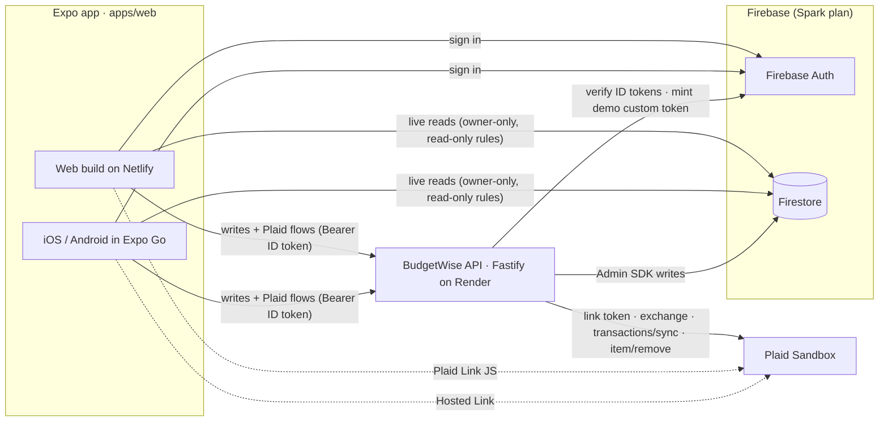
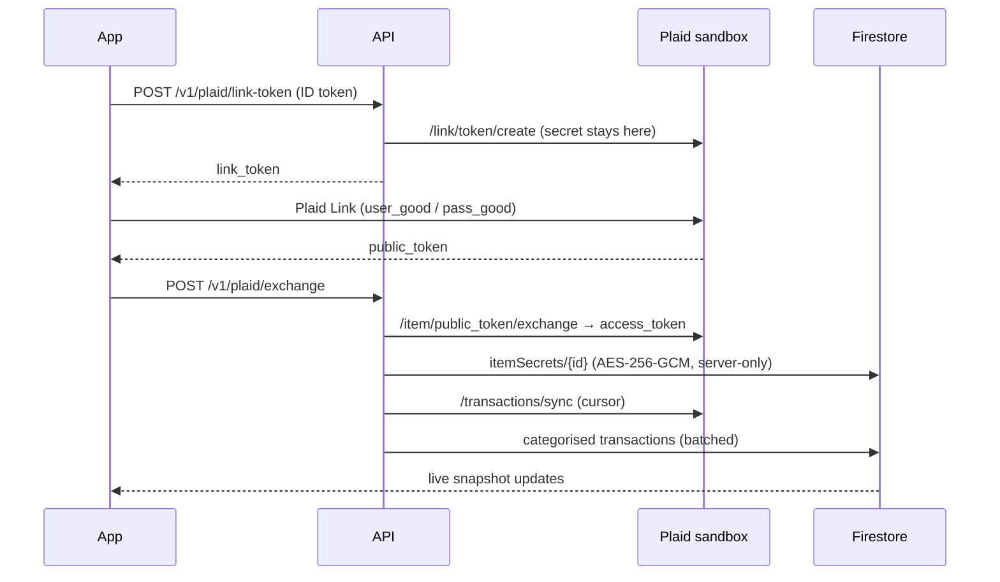

# BudgetWise

**Live demo: [budgetwise.temitopeagbola.com](https://budgetwise.temitopeagbola.com)** · click **Try the demo**, no sign-up needed.

BudgetWise is a personal finance app for iOS, Android and the web, built with Expo. You sign up, link a
bank through Plaid Link (sandbox), and BudgetWise imports your transactions, sorts each one into a
category with a rules engine you can override, tracks monthly budgets per category against an even-pace
marker, and charts where your money goes. A small Node.js API is the only thing that ever sees the Plaid
secret or a bank access token. Everything else streams live from Firestore, read-only, behind security
rules. It's a small but real MVP: real auth, real persistence, real Plaid integration, and tests from the
rules engine up to a browser-driven end-to-end run.

> The API runs on Render's free tier, which sleeps when idle. The first request after a quiet spell can
> take up to a minute; the app says **“Waking the server…”** while that happens.

| Overview                                   | Transactions                                       | Budgets                                  | Insights                                   |
| ------------------------------------------ | -------------------------------------------------- | ---------------------------------------- | ------------------------------------------ |
|  |  |  |  |

## Features

- **Accounts:** email/password sign-up and sign-in, password reset, and a one-click **demo account** with
  six months of seeded sandbox data (re-seeded every few hours so visitors always get a clean slate).
- **Bank linking:** Plaid Link in the browser, Plaid Hosted Link in Expo Go, and a built-in “sandbox
  bank” when the API runs without Plaid keys.
- **Transaction sync:** incremental `/transactions/sync` with cursors: pending → posted, modified and
  removed transactions; manual “Sync now”.
- **Auto-categorisation you control:** your rules → curated merchant keywords → Plaid's personal-finance
  category → Other. Override any transaction, or tick **“Always use this category”** to turn it into a
  rule that re-categorises past and future matches. Manual edits are never overwritten.
- **Rules editor:** match merchant or description (contains / equals / starts with), optional amount
  range, live “matches N transactions” preview.
- **Monthly budgets** per category, with progress, a pace marker (“where an even pace puts you today”),
  status icons and labels, and limits suggested from your last three months.
- **Insights:** KPI tiles, a six-month spending chart (tap a month to explore it), a spending-pace line
  chart against last month, and a category breakdown, all drawn with **Victory Native** (Skia).
- Loading, empty and error states everywhere; accessible labels, roles and visible focus rings;
  responsive from 375px phones to desktop.

## Architecture





**Key decisions**

- **One write path.** Clients may only _read_ their own `users/{uid}/**` documents
  ([`firestore.rules`](firestore.rules)). Every write goes through the API, which verifies the Firebase ID
  token and validates input with zod schemas shared with the app (`packages/core`). Reads stay fast and
  live even while the free API instance is asleep.
- **Secrets stay server-side.** The Plaid secret lives only in the API's environment. Access tokens are
  AES-256-GCM encrypted at rest in a collection clients cannot read; Link sessions are stored by SHA-256
  hash and bound to the user who started them.
- **Pure, shared domain logic.** Categorisation, budget maths and chart aggregation live in
  `packages/core` with no framework dependencies, so they are unit-tested in isolation and used
  identically by the API and the app.
- **Provider seam.** A `BankProvider` interface has two implementations: the real Plaid sandbox client
  and a deterministic mock, selected by `PLAID_PROVIDER`. Each linked item remembers which provider
  created it.

More detail: [docs/PLAN.md](docs/PLAN.md).

## Repository layout

```
apps/
  web/            Expo SDK 57 + Expo Router universal app (web export → Netlify; iOS/Android → Expo Go)
  api/            Node 22 + Fastify API: Plaid, sync, rules, budgets, demo sessions (→ Render)
packages/
  core/           Shared types, zod schemas, categorisation engine, budget + insight maths
e2e/              Playwright smoke test of the main flow
infra/firebase/   Docker image for the Auth + Firestore emulators
docs/             Plan, screenshots, Expo Go QR code
firestore.rules   Security rules (owner read-only, no client writes)
render.yaml       Render Blueprint for the API
netlify.toml      Netlify build for the web export
docker-compose.yml  The whole stack locally
```

## Run it locally

### Option A: Docker (one command)

```sh
docker compose up --build
```

| Service              | URL                          |
| -------------------- | ---------------------------- |
| Web app              | http://localhost:3000        |
| API                  | http://localhost:8787/health |
| Firebase Emulator UI | http://localhost:4000        |

This runs the Firebase Auth + Firestore emulators, the API (with the built-in sandbox bank and a seeded
demo account) and the web export behind nginx. No accounts or keys needed. To use the real Plaid sandbox
instead, create a `.env` with `PLAID_PROVIDER=plaid`, `PLAID_CLIENT_ID` and `PLAID_SECRET`.

### Option B: Node (hot reload)

Requires Node 22 and Java 21 (for the Firebase emulators).

```sh
npm install
npm run emulators          # terminal 1: Auth :9099, Firestore :8080, UI :4000
npm run dev:api            # terminal 2: API on :8787 (mock Plaid by default)
npm run seed               # optional: seed the demo account
npm run dev:web            # terminal 3: Expo dev server; press w for web
```

`apps/web` reads `EXPO_PUBLIC_*` variables; for local emulators create `apps/web/.env.local` with:

```sh
EXPO_PUBLIC_USE_FIREBASE_EMULATORS=true
EXPO_PUBLIC_API_URL=http://localhost:8787
```

**On a phone with Expo Go:** run `npm run start -w @budgetwise/web` and scan the QR code in the
terminal. When the API URL points at `localhost`, the app automatically swaps in your computer's LAN
address. To use the emulators from a phone, also set `EXPO_PUBLIC_FIREBASE_EMULATOR_HOST` to that
address.

## Tests

| Command                                                       | What it covers                                                                                                                                                                                                                                                           |
| ------------------------------------------------------------- | ------------------------------------------------------------------------------------------------------------------------------------------------------------------------------------------------------------------------------------------------------------------------ |
| `npm test`                                                    | 101 unit tests (vitest): rules engine, budgets, insights, dates/money and schemas (`core`); every API route via `fastify.inject`, Plaid provider (stubbed client), mock bank, encryption and config (`api`); API client retries, waking-server store and helpers (`web`) |
| `npm run e2e`                                                 | Playwright at 375px against the web export + API + emulators: sign up → link a bank → transactions stream in → recategorise with a rule → set a budget → charts render → sign out; plus the one-click demo                                                               |
| `npm run e2e:ci`                                              | The same, wrapped in `firebase emulators:exec` (what CI runs)                                                                                                                                                                                                            |
| `npm run lint` / `npm run typecheck` / `npm run format:check` | ESLint, strict TypeScript in every workspace, Prettier                                                                                                                                                                                                                   |

Build the web export for e2e first with `npm run build:web:e2e`. GitHub Actions runs lint, format,
typecheck and unit tests on every push and PR, then the e2e suite and `docker compose build`.

## Deploy

All free tiers: **Netlify** (web), **Render** (API), **Firebase Spark** (Auth + Firestore), **Plaid
sandbox**.

1. **Firebase:** create a project, enable **Authentication → Email/Password**, create a **Firestore**
   database, then publish the rules: `npx firebase-tools@15.33.0 deploy --only firestore:rules --project <id>`
   (or paste [`firestore.rules`](firestore.rules) into the console). Register a **Web app** for the
   `EXPO_PUBLIC_FIREBASE_*` values, and generate a **service account key** (Project settings → Service
   accounts) for the API. Add `budgetwise.temitopeagbola.com` under Authentication → Settings →
   Authorized domains.
2. **Plaid:** sign up at [dashboard.plaid.com](https://dashboard.plaid.com) and copy the **sandbox**
   `client_id` and `secret`.
3. **Render:** New → **Blueprint** → this repo. [`render.yaml`](render.yaml) creates the free web service
   and prompts for `PLAID_CLIENT_ID`, `PLAID_SECRET` and `FIREBASE_SERVICE_ACCOUNT` (paste the JSON, or
   base64 of it). `TOKEN_ENCRYPTION_KEY` is generated for you. Note the service URL.
4. **Netlify:** the existing `budgetwise` site already builds from this repo; [`netlify.toml`](netlify.toml)
   sets base `apps/web`, command `npm run build:web`, publish `dist`. Set the `EXPO_PUBLIC_*` variables
   (below) and redeploy.
5. **Expo Go (optional):** see [Open in Expo Go](#open-in-expo-go).

## Environment variables

Every variable is documented in [`.env.example`](.env.example).

**API (Render)**

| Variable                                                                        | Required     | Purpose                                                       |
| ------------------------------------------------------------------------------- | ------------ | ------------------------------------------------------------- |
| `PLAID_PROVIDER`                                                                | yes          | `plaid` (Plaid sandbox) or `mock` (built-in sandbox bank)     |
| `PLAID_CLIENT_ID`, `PLAID_SECRET`                                               | with `plaid` | Plaid **sandbox** keys; never sent to clients                 |
| `FIREBASE_SERVICE_ACCOUNT`                                                      | production   | Admin SDK credentials (raw or base64 JSON)                    |
| `TOKEN_ENCRYPTION_KEY`                                                          | production   | 32-byte key (base64/hex) encrypting Plaid access tokens       |
| `ALLOWED_ORIGINS`                                                               | yes          | CORS allow-list, e.g. `https://budgetwise.temitopeagbola.com` |
| `NODE_ENV`, `PORT`, `LOG_LEVEL`                                                 | no           | Runtime basics (Render sets `PORT`)                           |
| `DEMO_UID`, `DEMO_RESEED_HOURS`, `SEED_DEMO_ON_START`                           | no           | Shared demo account behaviour                                 |
| `HOSTED_LINK_REDIRECT_PREFIXES`                                                 | no           | Deep-link prefixes allowed for Hosted Link redirects          |
| `FIREBASE_PROJECT_ID`, `FIRESTORE_EMULATOR_HOST`, `FIREBASE_AUTH_EMULATOR_HOST` | local        | Emulator wiring                                               |

**Web app (Netlify, inlined at build time; all public by design)**

| Variable                                                                                                                             | Purpose                |
| ------------------------------------------------------------------------------------------------------------------------------------ | ---------------------- |
| `EXPO_PUBLIC_API_URL`                                                                                                                | The Render API URL     |
| `EXPO_PUBLIC_FIREBASE_API_KEY`, `EXPO_PUBLIC_FIREBASE_AUTH_DOMAIN`, `EXPO_PUBLIC_FIREBASE_PROJECT_ID`, `EXPO_PUBLIC_FIREBASE_APP_ID` | Firebase web config    |
| `EXPO_PUBLIC_USE_FIREBASE_EMULATORS`, `EXPO_PUBLIC_FIREBASE_EMULATOR_HOST`                                                           | Local development only |

## Open in Expo Go


Scan with the Expo Go app (iOS camera or Expo Go on Android) to run BudgetWise on your phone. The code
opens the latest **EAS Update** on the `production` channel, published by
[`.github/workflows/eas-update.yml`](.github/workflows/eas-update.yml) on every push to `main`.

To activate it (one time): in `apps/web` run `npx eas-cli@latest init` and
`npx eas-cli@latest update:configure`, commit the result, add an `EXPO_TOKEN` repository secret and the
`EXPO_PUBLIC_*` repository variables, push to `main`, then run `npm run expo:qr` and commit the
regenerated `docs/expo-go-qr.svg`. Until then the image above is a placeholder.

## Stack substitutions and why

| Planned                                 | Shipped                                                          | Why                                                                                                                                                             |
| --------------------------------------- | ---------------------------------------------------------------- | --------------------------------------------------------------------------------------------------------------------------------------------------------------- |
| Plaid                                   | **Plaid sandbox only**                                           | A portfolio app must never touch real bank credentials. `PLAID_ENV` only accepts `sandbox`.                                                                     |
| `react-native-plaid-link-sdk` on mobile | **Plaid Hosted Link** (+ Link JS on web)                         | The native SDK needs a custom dev build and cannot run in Expo Go. Hosted Link works in Expo Go and keeps the token exchange server-side via `/link/token/get`. |
| Plaid everywhere                        | **Mock provider when there are no keys** (`PLAID_PROVIDER=mock`) | The app, the demo, CI and `docker compose up` work with zero accounts; the mock mirrors Plaid's token and cursor contract.                                      |
| Client-side Firestore writes            | **Writes through the API**                                       | One validated write path, and security rules that are trivially auditable (no client writes at all).                                                            |
| Victory Native (mobile)                 | **Victory Native on web too, via Skia's CanvasKit WASM**         | The same chart code on all platforms. CanvasKit (~7 MB) is lazy-loaded only on the Insights screen.                                                             |
| Neon / Upstash / Atlas                  | **Not used**                                                     | The project's stack is Firebase: Firestore holds everything, so no separate database or cache is needed.                                                        |
| `apps/web`                              | **Universal Expo app**                                           | The folder name follows the repo convention; it builds the web export and the iOS/Android app.                                                                  |

## Security notes

- Plaid secret and access tokens never leave the API; access tokens are encrypted at rest.
- Firestore rules: owner read-only, no client writes, server-only collections unreadable.
- Firebase ID token verified on every API request; zod validation at every boundary; CORS allow-list;
  rate limits (global, tighter on demo sessions and link tokens); request body cap.
- Hosted Link redirect URIs are restricted to app deep-link prefixes; link sessions are bound to their user.
- The shared demo account can be modified by visitors and is re-seeded on a schedule.

## Known limitations and next steps

- Plaid webhooks (`SYNC_UPDATES_AVAILABLE`) are not wired yet; sync runs on link and on demand.
- The app streams the last six months of transactions; older history would need pagination.
- Firestore rules are exercised end to end, but not yet by dedicated `@firebase/rules-unit-testing` tests.
- No Content-Security-Policy yet (Plaid Link, Firebase and CanvasKit need a carefully scoped one).
- Mobile builds are verified by exporting the iOS/Android bundles; they have not been run through device
  automation in CI.
